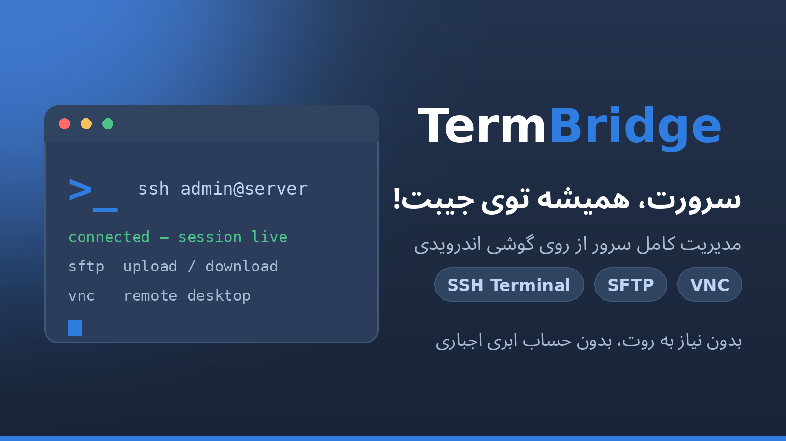

<p align="center">
  
</p>

<h1 align="center">TermBridge</h1>

<p align="center">
  <strong>Your server, always in your pocket.</strong><br>
  A real SSH terminal, two-way SFTP, per-host environments, one-tap
  command buttons and a VNC desktop — in one phone-first Android app.
  No mandatory cloud account. No root. No ads, no trackers.
</p>

<p align="center">
  <a href="https://github.com/PishiKuchulu/TermBridge/releases"></a>
  <a href="https://github.com/PishiKuchulu/TermBridge/actions/workflows/android-ci.yml"></a>
  
  
</p>

<p align="center">
  <a href="#english">English</a> · <a href="#فارسی">فارسی</a> ·
  <a href="https://github.com/PishiKuchulu/TermBridge/releases/latest"><strong>⬇ Download the latest signed release</strong></a>
</p>

---

<a name="english"></a>

## ✨ Why TermBridge?

Most mobile SSH clients lock the basics behind a paywall or a
cloud account. TermBridge is built the other way around:
everything below works **fully on-device**, for free, with your
credentials encrypted in the Android Keystore and never sent
anywhere.

| | |
|---|---|
| 🖥️ **Real terminal** | Own VT parser (incl. alternate screen) over an sshj shell channel — not a text-view fake |
| 📁 **Files both ways** | Streaming SFTP upload *and* download, to a local folder you pick |
| 🌱 **Per-host environment** | Env vars and working directories per host, applied at connect |
| 🔘 **Command buttons** | One-tap commands — including an *insert-only* mode that types text into the terminal without running it |
| 🖱️ **VNC desktop** | A remote desktop for Linux *and* Windows servers, over the same app |
| 🔐 **Locked down** | App lock (PIN + optional biometrics), host-key verification, SHA-256-verified in-app updates |
| 🎨 **Your look** | Terminal colour themes + the “Blue Cards” UI skin |

## 📥 Download & install

Grab `TermBridge-release.apk` from the
[latest release](https://github.com/PishiKuchulu/TermBridge/releases/latest)
and install it. Releases are signed with the project's release
key, and from v0.1.3 on the app can also **update itself**:
it downloads the new APK in-app, verifies its SHA-256 against
the digest GitHub publishes for the release asset, and only
then hands it to the system installer. A mismatch deletes the
file and refuses the install.

## 🧰 What works

- **Hosts + credentials** — Room profiles; Android Keystore
  AES-256-GCM encryption; host-key fingerprint verification
  (UNKNOWN / MATCH / CHANGED), with trust persisted only after
  successful auth and deleted with the host.
- **SSH terminal** — own VT parser (incl. alternate screen),
  sshj 0.40.0 shell channel, paste confirmation, control keys,
  pinned auto-scroll.
- **SFTP** — streaming upload/download, SAF-only local access,
  single-entry delete, path-traversal clamping.
- **Command buttons** — three strictly separate modes
  (insert-only / execute-one / sequence), `{{name}}` parameters
  with per-shell quoting (POSIX, PowerShell; parameterised
  buttons are refused on cmd.exe), risky-command second
  confirmation, secret-scan blocking saves. A parameterised
  button is refused at the execution boundary while the host's
  shell is unconfirmed or the prepared text is stale — in
  every mode, including insert-only. “Confirmed” means the
  user asserted the shell in Environment and saved it; the app
  cannot detect a remote shell, so confirmation is a user
  assertion, not an app verification.
- **Environment & paths** — per-host env vars (Keystore-
  encrypted, applied via sshj `setEnvVar`, never `export`
  injection) and working directories (one visible `cd` per
  shell, SFTP start directory). Buttons are never modified by
  env/cd.
- **Advanced SSH** — local + remote forwarding (loopback
  default), jump-host chains, unauthenticated SOCKS proxy.
  Dynamic forwarding, HTTP CONNECT, ProxyCommand and
  authenticated SOCKS are unavailable, with the reasons shown
  in the UI — nothing is faked.
- **Import/export** — one versioned JSON format (v1). The
  default export carries no secrets; the explicit encrypted
  backup uses PBKDF2 (600k iterations) + AES-256-GCM. Trusted
  host keys are never exported; import never trusts a key or
  executes a command.
- **App shell** — persisted settings (font size, scrollback,
  TERM type, keep-alive, colour schemes) in an accordion
  Settings screen, Vault / Connections / Settings navigation,
  known-hosts management, a local connection-history log,
  subnet discovery, quick-connect form pre-fill, and an
  optional app lock (salted PBKDF2 PIN with throttling,
  optional biometric unlock).

## 🚧 Honest limits

- **RDP is not supported.** It is blocked by a feasibility
  gate: there is no reliable open-source RDP library path for
  this build, so there is no RDP code and no fake connect
  button. (Candidate if that changes: FreeRDP 3.x.)
- **VNC is implemented but not yet device-proven.** The
  pure-Kotlin RFB core (3.3/3.7/3.8, None + VNC auth,
  Raw/CopyRect/RRE/CoRRE/Hextile) is wired to a remote-desktop
  screen (touch-as-mouse, key row, Unicode typing). In CI, the
  dedicated `vnc` job proves the protocol against a real
  x11vnc server (`RfbLiveTest`); the on-device screen and
  input path still await an owner's device run
  (`RfbIntegrationTest` is skipped in CI), so treat VNC as
  unverified on-device until that proof lands. VNC Auth is
  also weak by design (DES, 8-char password) — use it on
  trusted networks or through an SSH tunnel.

## 🔐 Security & privacy

- **Permissions** — INTERNET + ACCESS_NETWORK_STATE +
  REQUEST_INSTALL_PACKAGES in the app manifest (the last one
  only lets the system installer open the update APK the app
  itself downloaded; the install stays behind the system's
  per-app allowance), plus USE_BIOMETRIC / USE_FINGERPRINT
  contributed to the merged manifest by the AndroidX biometric
  library for the optional app lock. `allowBackup=false`
  (export is the migration path), cleartext traffic
  forbidden, exactly one exported component in app code (the
  launcher; the merged manifest also carries the AndroidX
  profile-installer receiver, guarded by the signature-level
  DUMP permission), FLAG_SECURE on the app window.
- **Secrets** — never plaintext, never logged, never
  hardcoded. Losing the Keystore means re-entering
  credentials; there is no recovery backdoor.
- **At-rest scope (audit #6, TB-010)** — “Keystore-encrypted”
  covers credentials, keychain keys and environment-variable
  **values**. Host names, usernames, env-var names,
  command-button templates, tunnel definitions, session
  transcripts and the connection log are stored unencrypted
  in app-private storage (protected by Android's per-app
  sandbox and `allowBackup=false`, not by cryptography). The
  threat model treats a compromised/unlocked device as out
  of scope; see `docs/SECURITY_KEY_LIFECYCLE.md`.
- **Audits** — this codebase has been through multiple
  independent line-by-line audits; every confirmed finding
  was fixed or explicitly dispositioned. Start at
  `docs/SECURITY_AUDIT.md`, `docs/SECURITY_FIXES_16.md`,
  `docs/CAPABILITY_CLAIM_AUDIT.md`,
  `docs/REVIEW_2_REMEDIATION.md`; remaining work is tracked
  in `docs/PARITY_TRACEABILITY.md`.

## 📊 Project status

Signed releases **v0.1.0 – v0.1.4** are published from this
tree (signature verified against the release keystore). The
tree currently carries `0.1.6-foundation` (versionCode 7)
and database v11. CI runs unit tests (**555 JVM tests**),
debug assemble and lint on every push, plus an emulator
instrumented job (30 tests: 28 passed, 2 VNC tests skipped)
and the x11vnc protocol job. Still open, honestly:
on-device verification runs and tier-2 integration tests —
see `docs/RELEASE_NOTES.md` for the release gates.

## 🛠️ Build

Toolchain: Gradle 8.10.2, AGP 8.7.3, Kotlin 2.0.21, JDK 17,
compile/target SDK 35, minSdk 26. The committed `gradlew`
wrapper is genuine (see `docs/DEVELOPMENT.md`).

```sh
./gradlew :app:testDebugUnitTest :app:assembleDebug --stacktrace
./gradlew :app:lintDebug
./gradlew :app:connectedDebugAndroidTest   # needs an emulator/device
```

**Server prerequisites** — a reachable SSH server (Linux/Unix,
or Windows with an SSH server configured — do not assume
Windows has one enabled); SFTP needs a compatible SFTP
subsystem on the server. Most servers accept only LANG/LC_*
environment variables by default.

## 📚 Docs map

- `docs/PROJECT_BRIEF.md`, `docs/ROADMAP.md`,
  `docs/REQUIREMENTS_MATRIX.md` — what was promised.
- `docs/PHASE_REPORT_01.md` … `docs/PHASE_REPORT_18.md` —
  one report per development phase, with evidence labels.
- `docs/CAPABILITY_MATRIX.md` — the full capability matrix
  (this README is only a summary).
- `docs/RELEASE_NOTES.md` — gates, open decisions,
  clean-tree checklist.
- `docs/DEVELOPMENT.md` — toolchain rationale and commands.
  `docs/TEST_MATRIX.md` — test coverage map.

## ⚠️ Known limitations (summary)

Alternate-screen `?47` unsupported; no terminal reflow; no
background service (process death loses the session); the
tunnel session is destination-scoped (leaving Advanced stops
tunnels); SFTP and terminal use separate SSH connections
(documented design decision); the upload picker cannot start
in the local folder (an `OpenDocument` contract limit). Full
list: `docs/CAPABILITY_MATRIX.md`.

## 📄 License

MIT — see [LICENSE](LICENSE). Shipped runtime dependencies
are all Apache 2.0: Jetpack Compose (BOM 2024.09.00),
Navigation Compose 2.8.0, Kotlin Coroutines 1.8.1, Room
2.6.1, sshj 0.40.0, kotlinx-serialization-json 1.7.3, Material
Icons Extended, AndroidX core/lifecycle/activity, AndroidX
Biometric 1.1.0. The About screen lists the same set.

---

<a name="فارسی"></a>

<div dir="rtl" align="right">

## فارسی

### سرورت، همیشه توی جیبت! 🚀

اپلیکیشن TermBridge برای مدیریت سرور از روی گوشی اندرویدی ساخته شده است؛ ترمینال واقعی SSH، انتقال فایل دوطرفه، محیط اختصاصی برای هر هاست، دکمه‌های فرمان یک‌لمسی و دسکتاپ از راه دور، همه در یک برنامهٔ گوشی‌محور. نه حساب ابری اجباری می‌خواهد، نه روت، و نه تبلیغ و ردیاب دارد.

بیشتر کلاینت‌های موبایل، امکانات پایه را پشت دیوار پرداخت یا حساب ابری قفل می‌کنند؛ مسیر TermBridge برعکس است: همهٔ امکانات زیر کاملاً روی خود گوشی کار می‌کنند و اطلاعات ورودت با رمزنگاری امن در Keystore اندروید نگه داشته می‌شوند و هیچ‌جا ارسال نمی‌شوند.

| | |
|---|---|
| 🖥️ **ترمینال واقعی** | تجزیه‌گر VT اختصاصی (با صفحهٔ جایگزین) روی کانال shell کتابخانهٔ sshj؛ نمای متنیِ صوری نیست |
| 📁 **فایل در هر دو جهت** | آپلود و دانلود جریانی با SFTP، به پوشهٔ محلی‌ای که خودت انتخاب می‌کنی |
| 🌱 **محیط اختصاصی هر هاست** | متغیرهای محیطی و پوشهٔ کاری جدا برای هر هاست، اعمال‌شده هنگام اتصال |
| 🔘 **دکمه‌های فرمان** | اجرای فرمان با یک لمس؛ با حالت «فقط درج» متن داخل ترمینال تایپ می‌شود و اجرا نمی‌شود |
| 🖱️ **دسکتاپ VNC** | دسکتاپ از راه دور برای سرورهای لینوکسی و ویندوزی، در همان برنامه |
| 🔐 **قفل و امنیت** | قفل برنامه با پین و اثر انگشت، بررسی اثر انگشت هاست، و به‌روزرسانی داخل برنامه با بررسی هش SHA-256 |
| 🎨 **ظاهر دلخواه** | تم‌های رنگی ترمینال و پوستهٔ رابط کاربری Blue Cards |

### 📥 دانلود و نصب

فایل `TermBridge-release.apk` را از [آخرین ریلیز](https://github.com/PishiKuchulu/TermBridge/releases/latest) بگیر و نصب کن. ریلیزها با کلید انتشار پروژه امضا می‌شوند و از نسخهٔ ۰٫۱٫۳ به بعد، برنامه خودش هم به‌روز می‌شود: فایل نسخهٔ تازه داخل خود برنامه دانلود می‌شود، هش SHA-256 آن با هشی که گیت‌هاب برای فایل ریلیز منتشر کرده مقایسه می‌شود و فقط بعد از تأیید، نصب‌کنندهٔ سیستم باز می‌شود. اگر هش نخواند، فایل پاک می‌شود و نصب انجام نمی‌شود.

### 🧰 چه چیزهایی کار می‌کند

- **هاست‌ها و اطلاعات ورود** — پروفایل‌ها در Room نگه داشته می‌شوند؛ رمزنگاری با AES-256-GCM در Keystore اندروید انجام می‌شود؛ اثر انگشت کلید هاست بررسی می‌شود (ناشناس / منطبق / تغییرکرده) و اعتماد فقط بعد از ورود موفق ذخیره و همراه هاست پاک می‌شود.
- **ترمینال SSH** — تجزیه‌گر VT اختصاصی (با صفحهٔ جایگزین)، کانال shell کتابخانهٔ sshj نسخهٔ 0.40.0، تأیید هنگام چسباندن متن، کلیدهای کنترلی و چسبیدن خودکار به انتهای خروجی.
- **انتقال فایل SFTP** — آپلود و دانلود جریانی، دسترسی محلی فقط از راه SAF، حذف تکی و مهار مسیرهای مخرب.
- **دکمه‌های فرمان** — سه حالت کاملاً جدا (فقط درج / اجرای تکی / زنجیره‌ای)، پارامترهای `{{name}}` با نقل‌قول‌گذاری مخصوص هر پوسته (POSIX و PowerShell؛ دکمهٔ پارامتری روی cmd.exe رد می‌شود)، تأیید دوم برای فرمان‌های پرخطر و اسکن راز هنگام ذخیره. دکمهٔ پارامتری وقتی پوستهٔ هاست تأیید نشده یا متن آماده‌شده کهنه شده باشد، در مرز اجرا رد می‌شود؛ در هر سه حالت، حتی فقط درج. منظور از «تأییدشده» این است که کاربر پوسته را در بخش محیط هاست اعلام و ذخیره کرده باشد؛ برنامه نمی‌تواند پوستهٔ سمت سرور را تشخیص دهد، پس تأیید، گفتهٔ کاربر است نه راستی‌آزمایی برنامه.
- **محیط و مسیرها** — متغیرهای محیطی هر هاست (رمزنگاری‌شده در Keystore و اعمال‌شده با `setEnvVar` در sshj، هرگز با تزریق `export`) و پوشه‌های کاری (یک `cd` آشکار برای هر پوسته و پوشهٔ شروع SFTP). دکمه‌ها هرگز با محیط یا پوشهٔ کاری تغییر نمی‌کنند.
- **SSH پیشرفته** — فورواردینگ محلی و راه‌دور (پیش‌فرض روی loopback)، زنجیرهٔ هاست‌های واسط و پروکسی SOCKS بدون احراز هویت. فورواردینگ پویا، CONNECT در HTTP، ‏ProxyCommand و SOCKS با احراز هویت در دسترس نیستند و دلیلش داخل رابط کاربری گفته می‌شود؛ چیزی جعل نمی‌شود.
- **ورود و خروج داده** — یک قالب JSON نسخه‌دار (نسخهٔ ۱). خروجی پیش‌فرض هیچ رازی ندارد؛ پشتیبان رمزنگاری‌شدهٔ صریح با PBKDF2 ‏(۶۰۰ هزار دور) و AES-256-GCM ساخته می‌شود. کلیدهای مورد اعتماد هاست هرگز صادر نمی‌شوند و ورود داده هرگز به کلیدی اعتماد نمی‌کند یا فرمانی اجرا نمی‌کند.
- **پوستهٔ برنامه** — تنظیمات ذخیره‌شونده (اندازهٔ قلم، اندازهٔ بافر خروجی، نوع TERM، نگه‌داری اتصال و طرح‌های رنگی) در صفحهٔ تنظیمات آکاردئونی، پیمایش Vault و Connections و Settings، مدیریت هاست‌های شناخته‌شده، گزارش محلی تاریخچهٔ اتصال، کشف دستگاه‌های زیرشبکه، پرکردن خودکار فرم اتصال سریع و قفل اختیاری برنامه (پین با PBKDF2 نمک‌دار و محدودیت تلاش، با بازکردن اختیاری با اثر انگشت).

### 🚧 محدودیت‌ها، صادقانه

- **‏RDP پشتیبانی نمی‌شود.** یک دروازهٔ امکان‌سنجی آن را بسته است: برای این بیلد مسیر مطمئنی با کتابخانهٔ متن‌باز RDP وجود ندارد، پس نه کدی برایش هست و نه دکمهٔ اتصال صوری. (نامزد آینده، اگر شرایط عوض شود: FreeRDP 3.x.)
- **‏VNC پیاده شده ولی هنوز روی دستگاه واقعی اثبات نشده است.** هستهٔ خالص کاتلینی پروتکل RFB ‏(نسخه‌های 3.3/3.7/3.8، احراز هویت None و VNC، کدگذاری‌های Raw و CopyRect و RRE و CoRRE و Hextile) به صفحهٔ دسکتاپ از راه دور وصل است (لمس به‌جای موش، ردیف کلید و تایپ یونیکد). در CI، جاب اختصاصی `vnc` پروتکل را در برابر یک سرور واقعی x11vnc اثبات می‌کند (`RfbLiveTest`)؛ ولی صفحه و ورودی روی دستگاه واقعی هنوز منتظر اجرای مالک روی گوشی است (`RfbIntegrationTest` در CI رد می‌شود)، پس تا آن اثبات، VNC روی دستگاه را تأییدنشده بدان. احراز هویت VNC ذاتاً هم ضعیف است (DES و رمز ۸کاراکتری)؛ فقط روی شبکه‌های مورد اعتماد یا از داخل تونل SSH استفاده‌اش کن.

### 🔐 امنیت و حریم خصوصی

- **مجوزها** — مجوزهای INTERNET و ACCESS_NETWORK_STATE و REQUEST_INSTALL_PACKAGES در مانیفست برنامه‌اند (آخری فقط به نصب‌کنندهٔ سیستم اجازه می‌دهد فایل به‌روزرسانی‌ای را باز کند که خود برنامه دانلود کرده است؛ نصب همچنان پشت اجازهٔ جداگانهٔ سیستم برای هر برنامه می‌ماند) و مجوزهای USE_BIOMETRIC و USE_FINGERPRINT از کتابخانهٔ بیومتریک AndroidX برای قفل اختیاری برنامه به مانیفست نهایی می‌آیند. گزینهٔ `allowBackup` خاموش است (مسیر مهاجرت، خروجی داده است)، ترافیک متن‌آشکار ممنوع است، در کد برنامه فقط یک کامپوننت صادرشده هست (لانچر؛ در مانیفست نهایی، رسیور پروفایل‌اینستالر AndroidX هم هست که با مجوز DUMP در سطح امضا محافظت می‌شود) و پنجرهٔ برنامه FLAG_SECURE دارد.
- **رازها** — هرگز متن‌آشکار نیستند، هرگز لاگ نمی‌شوند و هرگز در کد ثابت نیستند. اگر Keystore از دست برود، اطلاعات ورود باید دوباره وارد شوند؛ هیچ در پشتی برای بازیابی وجود ندارد.
- **دامنهٔ رمزنگاری در حالت سکون (ممیزی ۶، TB-010)** — عبارت «رمزنگاری‌شده در Keystore» رمزهای ورود، کلیدهای کی‌چین و **مقادیر** متغیرهای محیطی را پوشش می‌دهد. نام هاست، نام کاربری، نام متغیرهای محیطی، قالب دکمه‌های فرمان، تعریف تونل‌ها، رونوشت نشست‌ها و گزارش اتصال، رمزنگاری‌نشده در حافظهٔ خصوصی برنامه نگه داشته می‌شوند (محافظت‌شده با سندباکس هر برنامه در اندروید و خاموش بودن `allowBackup`، نه با رمزنگاری). مدل تهدید، دستگاه به‌خطرافتاده یا بازشده را خارج از دامنه می‌داند؛ جزئیات در `docs/SECURITY_KEY_LIFECYCLE.md` است.
- **ممیزی‌ها** — این کدبیس چند ممیزی مستقل و خط‌به‌خط را پشت سر گذاشته است؛ هر یافتهٔ تأییدشده یا اصلاح شده یا صریحاً تعیین‌تکلیف شده است. نقطهٔ شروع: `docs/SECURITY_AUDIT.md` و `docs/SECURITY_FIXES_16.md` و `docs/CAPABILITY_CLAIM_AUDIT.md` و `docs/REVIEW_2_REMEDIATION.md`؛ کار باقی‌مانده در `docs/PARITY_TRACEABILITY.md` ردیابی می‌شود.

### 📊 وضعیت پروژه

ریلیزهای امضاشدهٔ **v0.1.0 تا v0.1.4** از همین درخت منتشر شده‌اند (امضا در برابر کلید انتشار راستی‌آزمایی شده است). درخت فعلی نسخهٔ `0.1.6-foundation` (کد نسخه ۷) و پایگاه دادهٔ نسخهٔ ۱۱ را دارد. در CI برای هر پوش، تست‌های واحد (**۵۵۵ تست JVM**)، بیلد دیباگ و لینت اجرا می‌شوند و جداگانه جاب تست اینسترومنتد روی شبیه‌ساز (۳۰ تست: ۲۸ قبول و ۲ تست VNC ردشده) و جاب پروتکل x11vnc هم هست. صادقانه باز است: اجراهای راستی‌آزمایی روی دستگاه واقعی و تست‌های یکپارچهٔ ردهٔ ۲؛ دروازه‌های انتشار در `docs/RELEASE_NOTES.md` آمده‌اند.

### 🛠️ بیلد

زنجیرهٔ ابزار: Gradle 8.10.2 و AGP 8.7.3 و Kotlin 2.0.21 و JDK 17، ‏compile/target SDK 35 و minSdk 26. رپر `gradlew` داخل مخزن اصل است (بنگر به `docs/DEVELOPMENT.md`).

```sh
./gradlew :app:testDebugUnitTest :app:assembleDebug --stacktrace
./gradlew :app:lintDebug
./gradlew :app:connectedDebugAndroidTest   # needs an emulator/device
```

**پیش‌نیاز سمت سرور** — یک سرور SSH در دسترس (لینوکس/یونیکس، یا ویندوز با سرور SSH پیکربندی‌شده؛ فرض نکن در ویندوز فعال است)؛ برای SFTP هم زیرسیستم سازگار SFTP روی سرور لازم است. بیشتر سرورها به‌صورت پیش‌فرض فقط متغیرهای محیطی LANG و LC_* را می‌پذیرند.

### 📚 نقشهٔ اسناد

- ‏`docs/PROJECT_BRIEF.md` و `docs/ROADMAP.md` و `docs/REQUIREMENTS_MATRIX.md` — آنچه وعده داده شده بود.
- ‏`docs/PHASE_REPORT_01.md` تا `docs/PHASE_REPORT_18.md` — برای هر فاز توسعه یک گزارش، با برچسب شواهد.
- ‏`docs/CAPABILITY_MATRIX.md` — ماتریس کامل قابلیت‌ها (این README فقط خلاصه است).
- ‏`docs/RELEASE_NOTES.md` — دروازه‌ها، تصمیم‌های باز و چک‌لیست درخت تمیز.
- ‏`docs/DEVELOPMENT.md` — منطق زنجیرهٔ ابزار و دستورها. ‏`docs/TEST_MATRIX.md` — نقشهٔ پوشش تست.

### ⚠️ محدودیت‌های شناخته‌شده (خلاصه)

صفحهٔ جایگزین `?47` پشتیبانی نمی‌شود؛ بازچینی (reflow) ترمینال نیست؛ سرویس پس‌زمینه نیست (مرگ فرایند، نشست را از بین می‌برد)؛ نشست تونل محدود به مقصد است (ترک بخش Advanced تونل‌ها را متوقف می‌کند)؛ ‏SFTP و ترمینال از دو اتصال SSH جدا استفاده می‌کنند (تصمیم طراحیِ مستندشده)؛ انتخاب‌گر آپلود نمی‌تواند از پوشهٔ محلی شروع شود (محدودیت قرارداد `OpenDocument`). فهرست کامل: `docs/CAPABILITY_MATRIX.md`.

### 📄 مجوز

مجوز پروژه MIT است — بنگر به [LICENSE](LICENSE). وابستگی‌های زمان اجرای منتشرشده همه Apache 2.0 هستند: ‏Jetpack Compose ‏(BOM 2024.09.00)، ‏Navigation Compose 2.8.0، ‏Kotlin Coroutines 1.8.1، ‏Room 2.6.1، ‏sshj 0.40.0، ‏kotlinx-serialization-json 1.7.3، ‏Material Icons Extended، هسته و چرخهٔ حیات و اکتیویتی AndroidX و ‏AndroidX Biometric 1.1.0. صفحهٔ «درباره» داخل برنامه همین فهرست را نشان می‌دهد.

</div>
